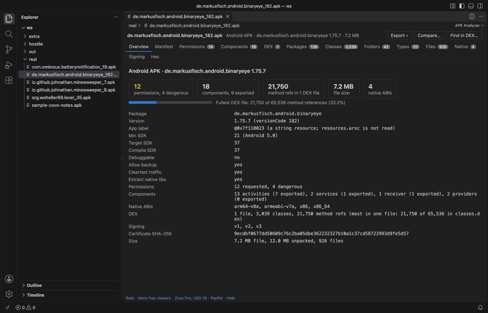
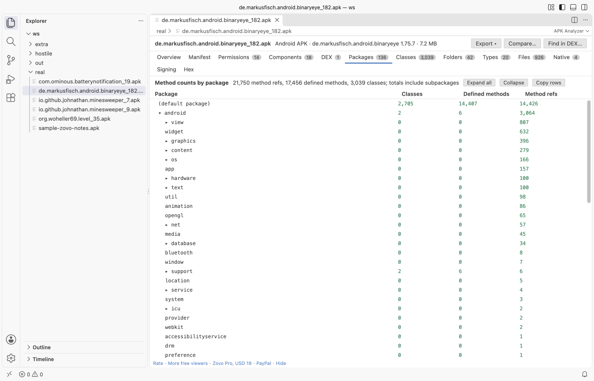
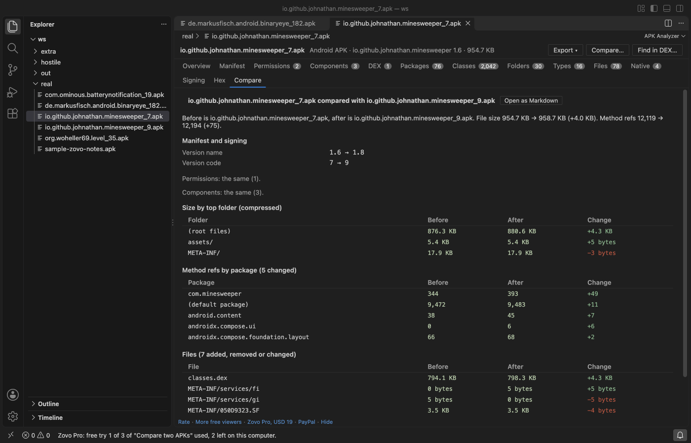

# APK Analyzer & APK Viewer (AndroidManifest, DEX Method Count, APK Size)

An APK analyzer and APK viewer for VS Code. Click an `.apk` file and read what is inside it: the decoded `AndroidManifest.xml`, the permissions it asks for, which activities and services are exported, DEX method counts by package against the 65,536 limit, where the bytes go by folder and file type, the native ABIs, and the signing certificate. `.aab`, `.apks` and `.xapk` files open too.

It is read-only and works offline: no network calls, no telemetry, no Android SDK, no Java.

## What you see

- Overview: package name, versionName and versionCode, min, target and compile SDK (with the Android version), the app label when it is a literal string, debuggable, allowBackup and cleartext traffic flags, counts of permissions and components, native ABIs, DEX totals and the signing schemes.
- Manifest: `AndroidManifest.xml` decoded from Android binary XML into readable, indented XML. Resource references stay as ids such as `@0x7f0e001b`. Copy it, or open it as an XML document.
- Permissions: every `uses-permission`, with the dangerous (runtime) ones flagged from a built-in list, special-access permissions named, and the permissions the app declares itself.
- Components: activities, activity aliases, services, receivers and providers, each with its exported flag and the reason: set in the manifest, implied by an intent filter on targetSdk below 31, or the default. The launcher activity is marked.
- DEX: each `classes*.dex` with its version, class count, defined methods, method references and the share of the 65,536 limit, plus field, string, type and prototype counts.
- Packages: method counts as a tree with totals per package (classes, defined methods, method references), the way the classic dex method count tools show them.
- Classes: every class the DEX files define, with its package, method and field counts, access flags and superclass.
- Size by folder, File types and Files: compressed and unpacked size of every folder (subfolders included), every file type and every file, largest first. Sort and filter any column.
- Native libs: the ABIs under `lib/` with their libraries and sizes.
- Signing: v1 (JAR) signature files, the APK Signing Block with its v2, v3 and v3.1 blocks (found by its magic before the central directory), and the signer certificate: SHA-256, SHA-1, subject, issuer, validity and key type. The extension shows the signature data; it does not verify signatures.
- Hex: the bytes of the whole file, or the unpacked bytes of any entry (the hex link on the Files tab).

## Other package types

- `.aab` (Android App Bundle): files, sizes, DEX counts, native ABIs and signing. In a bundle the manifest is a protocol buffer, which this version does not decode; the Manifest tab says so.
- `.apks` (APK set) and `.xapk`: the APKs inside are listed, and the base APK is analysed in the other tabs.

## Large and damaged files

Only the central directory, the manifest, the DEX files and the signature files are read when a file opens. A 200 MB APK with large assets opens without reading the assets; an entry is unpacked only when you open it in the hex view. Every reader runs in a worker thread with a memory cap and a time limit, and every count is checked against the bytes that are really there, so a damaged or hostile file gives a message and whatever could be read. Unpacking stops at the size the archive header gives, so a zip bomb is stopped early.

## Zovo Pro tools

Three tools for release work are part of Zovo Pro. Each one has 3 free tries on your computer, and a try is used only when the tool produced its result:

1. Compare two APKs: size by file and folder (+/-), permissions, components and SDK levels added or removed, signing changes, and method references per package, with a Markdown report.
2. Export the report: the whole analysis as JSON or Markdown, or the file size and method count tables as CSV.
3. Find in DEX: find a class, method, field or string in every DEX file of the APK (plain text or `/regex/`).

Nothing about Pro appears when you open a file. To hide the three buttons, turn off `apkAnalyzer.showProTools`.

## Settings

| Setting | Default | What it does |
|---|---|---|
| `apkAnalyzer.showProTools` | `true` | Show the Export, Compare and Find in DEX buttons |
| `apkAnalyzer.showSupportLinks` | `true` | Show the small links at the bottom of the viewer |
| `apkAnalyzer.askForRating` | `true` | Ask once, after a few days of use, for a rating |

## Notes

- Not affiliated with Google, Android or Android Studio. "Android" is a trademark of Google LLC.
- The app label is shown when the manifest has it as a literal string. Labels stored as string resources show their resource id, because `resources.arsc` is not read.
- Files on remote or virtual file systems are read into memory up to 256 MB.

## Support Zovo

Zovo Pro: USD 19 once, every Zovo viewer. [Get Zovo Pro on GitHub Sponsors](https://github.com/sponsors/theluckystrike/sponsorships?tier_id=679878) to turn on the Pro tools in this extension and in the other Zovo extensions you use. The free features stay free.

Zovo extensions have no ads and no tracking. They are made by [theluckystrike](https://github.com/theluckystrike) on GitHub. You can also support the work with no Pro:

- [Sponsor on GitHub](https://github.com/sponsors/theluckystrike)
- [PayPal](https://www.paypal.com/paypalme/najzzz)
- [Follow theluckystrike on GitHub](https://github.com/theluckystrike)

### Need your format supported?

Open a [format request](https://github.com/theluckystrike/apk-analyzer-vscode/issues/new?template=format-request.yml) with a sample file, and I reply there whether it can be done. For USD 299 once, through [this GitHub Sponsors tier](https://github.com/sponsors/theluckystrike/sponsorships?tier_id=679995), I add your file format or a missing feature to this extension, with tests, within 7 days.

## More tools by Zovo

- [Hex Viewer & Binary Viewer, Hex Editor (Large Files)](https://marketplace.visualstudio.com/items?itemName=zovo.zovo-hex-viewer) opens binary files of any size, with find, a data inspector and byte editing.
- [SVN Client & Subversion Source Control (Commit, Blame, Log, Diff)](https://marketplace.visualstudio.com/items?itemName=zovo.zovo-svn-client) brings SVN commit, diff, log and blame to the Source Control view.
- [ZIP Viewer & Archive Explorer (JAR, TAR, GZ)](https://marketplace.visualstudio.com/items?itemName=zovo.zip-archive-explorer) browses ZIP, JAR, VSIX, TAR and GZ files, opens entries in tabs and extracts them safely.
- [VCD Viewer & Waveform Viewer (Verilog, No Signal Limit)](https://marketplace.visualstudio.com/items?itemName=zovo.zovo-vcd-waveform-viewer) opens Verilog, SystemVerilog and VHDL VCD waveforms with no signal limit.
- [Linker Map Viewer & Map File Analyzer (GNU ld, Memory Usage)](https://marketplace.visualstudio.com/items?itemName=zovo.zovo-linker-map-viewer) shows FLASH and RAM use from GNU ld, lld, IAR and Keil map files.

See [all Zovo extensions on the Marketplace](https://marketplace.visualstudio.com/publishers/zovo).

## License

MIT
